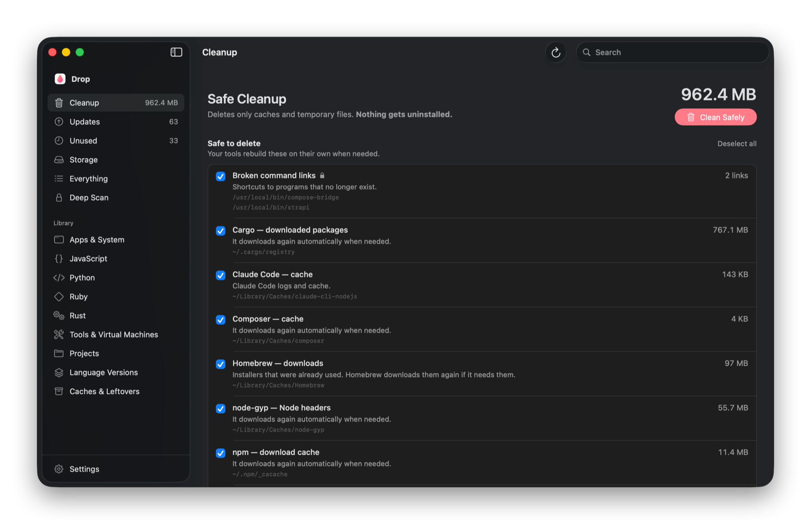
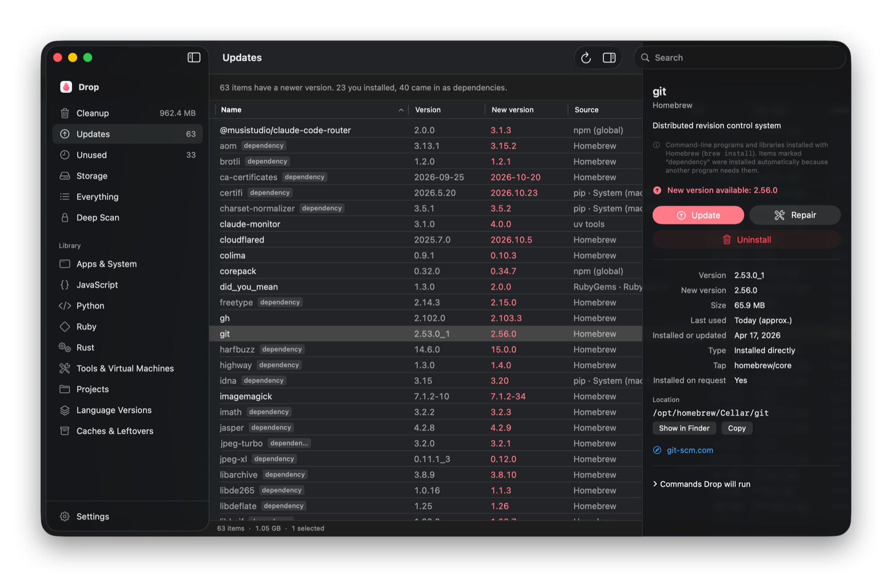
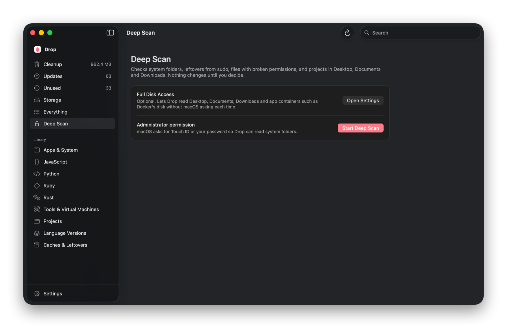

<p align="center">
  
</p>

<h1 align="center">Drop</h1>

<h3 align="center">The uninstaller for everything your terminal installed.</h3>

<p align="center">
  See every package, library, SDK and cache on your Mac in one place.<br/>
  Free up gigabytes with one click, without breaking anything.
</p>

<p align="center">
  <a href="../../releases/latest"></a>
</p>

<p align="center">
  
  
  
  
  
</p>

<p align="center">
  
</p>

---

## Why Drop?

Every `npm install -g`, `pip install`, `brew install`, `cargo install` and `npx` leaves something behind. A few months later you have no idea what's on your Mac, which version of Node you're using, or why your disk is full.

macOS has no place that shows you all of this. **Drop is that place.**

Open it and in about two seconds you see everything, where it lives, how big it is, when you last used it, and what you can safely remove.

## What you can do

- **Safe Cleanup.** Frees space by deleting only caches and temporary files that your tools rebuild on their own. Nothing gets uninstalled. You see every folder and its size before anything happens.
- **See everything installed.** Homebrew, npm, pip, uv, Cargo, Go, Ruby gems, VS Code extensions, Docker images, AI models, Xcode simulators and more than 100 other sources.
- **Update with a click.** Drop tells you what has a newer version and updates it for you.
- **Find what you never use.** Spot the tools and libraries you haven't touched in months.
- **See what takes up space.** Sort everything from largest to smallest, or the other way around.
- **Uninstall properly.** Drop uses each tool's own uninstall command, so nothing is left half-removed.
- **Deep Scan.** With Touch ID or your password, Drop also checks system folders, leftovers from `sudo`, and files with broken permissions (the cause of the classic `EACCES` error).
- **English and Spanish.** Switch the language anytime in Settings.

<div align="center">

</div>

## Install

1. Download **Drop.zip** from the [latest release](../../releases/latest).
2. Unzip it and drag **Drop** into your **Applications** folder.
3. The first time, right-click Drop and choose **Open**. macOS asks this once because Drop is not distributed through the App Store.

Requires macOS 14 Sonoma or later. Works on Apple Silicon and Intel.

## Is it safe?

Yes. Drop was built around one rule: **never delete something you didn't choose.**

- **Safe Cleanup only touches caches** that the tool itself would recreate, such as npm's download cache, pip's cache or Xcode's DerivedData. Anything that would need a big re-download (AI models, test browsers, Maven artifacts) is listed separately as *Optional* and is **unchecked by default**.
- **It never touches credentials.** For example, it cleans the Hugging Face model cache but never your access token stored next to it.
- **Every action shows the exact command** before it runs, and asks for confirmation.
- **Uninstalls use the official command** of each package manager (`brew uninstall`, `npm uninstall -g`, `pip uninstall`, `cargo uninstall`…), not a blind `rm -rf`.
- **Administrator actions** use the native macOS prompt with Touch ID or your password. Drop never stores or sees your password.
- **100% local.** No accounts, no analytics, no network calls except the ones your own package managers make when checking for updates.

## Deep Scan

Some things can only be seen with extra permission. Deep Scan asks for two things, and you decide:

| Permission | What it unlocks |
|---|---|
| **Full Disk Access** (optional) | Lets Drop look inside Desktop, Documents, Downloads and app containers (such as Docker Desktop's virtual disk) without macOS asking each time. |
| **Administrator** (Touch ID or password) | Caches left by `sudo npm/pip/gem`, root-owned files inside your home folder, crash dumps in `/cores`, and system-wide installs like python.org, Java JDKs, AWS CLI, .NET, Go, Mono, R, MacTeX and anything in `/opt`. It also searches your Desktop, Documents and Downloads for project folders like `node_modules`, `.venv` and build output. |

Files with broken permissions get a **Repair** button that gives them back to your user without deleting anything.

<div align="center">

</div>

## What Drop finds

Drop only shows sources that exist on your Mac.

| Category | Sources |
|---|---|
| **Apps & System** | Homebrew formulae, casks and taps (Apple Silicon and Intel), MacPorts, Nix, `.pkg` installers |
| **JavaScript** | npm global, npx cache, pnpm, Yarn, Bun, Deno, Volta |
| **Python** | pip for every interpreter (system, Homebrew, python.org, pyenv, asdf, mise, uv, rye), pipx, uv tools, Conda/Mamba, Poetry, pipenv, Hatch, virtualenvwrapper, pyenv-virtualenv, Jupyter kernels |
| **Other languages** | RubyGems, Cargo, `go install`, Composer, PECL, .NET tools and workloads, Dart pub, LuaRocks, opam, Cabal, R, Julia, Mint, Mix, nimble, jbang, Coursier, pixi, pkgx |
| **Language versions** | nvm, fnm, n, nodenv, nvs, asdf, mise, proto, vfox, pyenv, uv, rye, rbenv, rvm, chruby, rustup, gvm, goenv, JDKs, jabba, SDKMAN!, fvm, ghcup, Stack, kiex, kerl, choosenim, zvm, juliaup, plenv, perlbrew, tfenv, tenv, Kotlin/Native, Swift toolchains, Android SDK, Xcode, Claude Code |
| **Tools & VMs** | VS Code, Cursor, Windsurf, VSCodium, Trae and Kiro extensions, GitHub CLI extensions, Ollama models, Docker and Podman images, Helm, krew, gcloud, Azure CLI, Pulumi, Arduino, PlatformIO, ESP-IDF, Unity, Godot, Colima, Lima, Vagrant, minikube, OrbStack, Android emulators, iOS simulators |
| **Projects** | `node_modules`, `.venv`, `target`, `Pods`, `.build`, `.next`, `.gradle`, `_build` and more inside your projects. Desktop, Documents and Downloads are included in Deep Scan, so a normal scan never triggers macOS privacy prompts. |
| **Caches & leftovers** | About 100 known developer caches, each classified as *safe* or *optional*, plus broken command links, old editor extensions and crash reports |

Missing something? [Open an issue](../../issues) with the tool name and where it installs things.

## FAQ

**Will Safe Cleanup break my projects?**
No. It only deletes caches that tools recreate automatically. The worst case is that the next install downloads a few files again.

**Why does Drop ask for my password?**
Only for Deep Scan and for actions on files owned by the system (for example, packages installed with `sudo`). macOS shows its own prompt; Drop never sees your password.

**How does Drop know when I last used something?**
It looks at when the files of each package were last opened. It's an approximation, so it's shown as "approx."

**Does it work without Xcode?**
Yes. Drop only needs macOS. Xcode-related sections appear only if Xcode is installed.

---

## For developers

### How it works

Drop is a native SwiftUI app with no third-party dependencies.

- **Scanners** run in parallel, one per source. Each scanner reads the package manager's own metadata (for example `brew info --json=v2 --installed`, `npm root -g`, `importlib.metadata` for every Python interpreter, `~/.cargo/.crates2.json`, VS Code's `extensions.json`, Ollama manifests) and returns packages with their path and the exact update, repair and uninstall commands.
- **Your real `PATH`** is resolved from your login shell, because apps opened from Finder get a minimal environment.
- **Sizes and last-used dates** are computed in the background from allocated file sizes and access times. Metadata files that Drop itself reads are ignored, so they don't skew the dates.
- **Commands** run through `/bin/zsh` with live output. If one fails with a permission error, Drop offers to retry with administrator rights through `NSAppleScript`, which shows the native Touch ID or password prompt.
- **Newer versions** are fetched after the scan finishes (`npm outdated`, `pip list --outdated`, `uv tool list --outdated`, `gem outdated`, `composer outdated`).

### Run from source

```bash
git clone <this repository>
cd Drop
swift run -c release
```

Only the Xcode Command Line Tools are required.

### Project layout

```
Sources/Drop
├── Core        Model, shell execution, state, sizes, deep scan, localization
├── Scanners    One scanner per source, plus the cache catalog
└── Views       Cleanup, sidebar, table, details, deep scan, settings
```

### Adding a source

1. Create a type that conforms to `Scanner` and returns `[Package]` from `scan(_:)`.
2. For each package, set `path` and the `commands` for `.update`, `.repair` and `.remove`.
3. Add a `SourceInfo` to `Src` and register the scanner in `Registry.all`.
4. Optionally implement `latestVersions(_:_:)` to report updates.

New caches go in `CacheCatalog` with a `safety` of `.safe` (always rebuilt automatically) or `.optional` (needs a manual step or a large download).

### Contributing

Pull requests are welcome, especially new scanners and cache entries. Please include where the tool stores its files on macOS and the official command to uninstall or clean it.

## License

MIT

<div align="center">
<br/>

**If Drop freed up space on your Mac, consider starring the repo so other developers can find it.**

</div>
